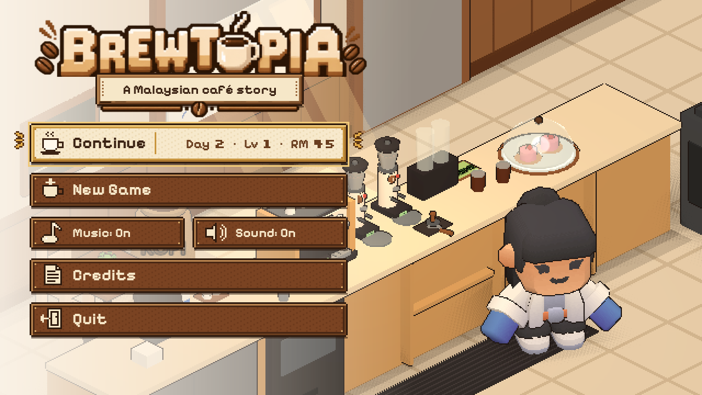
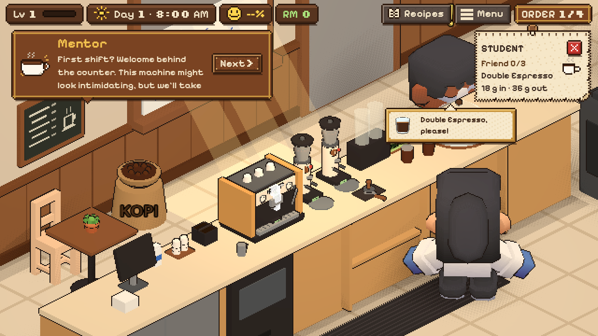
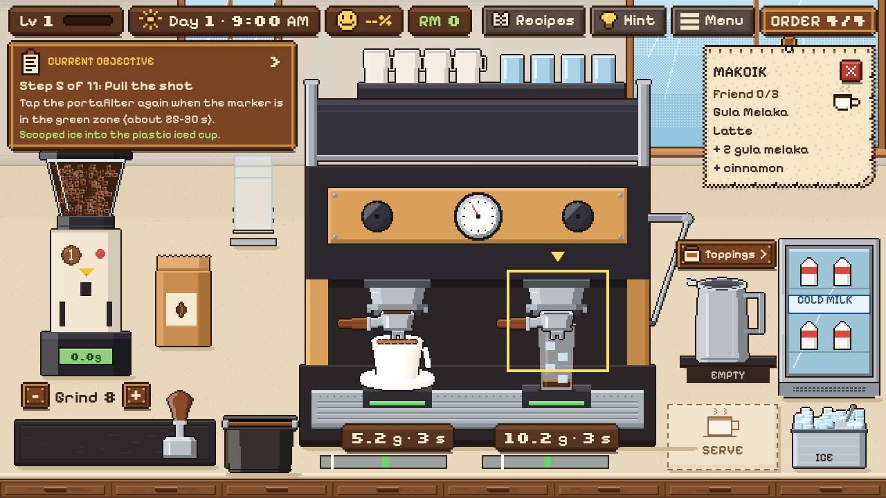
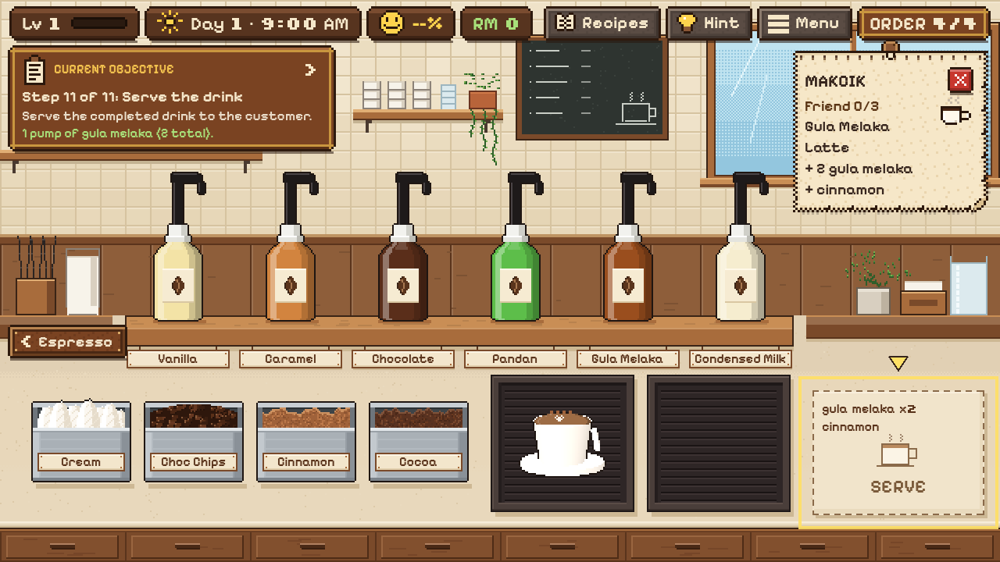
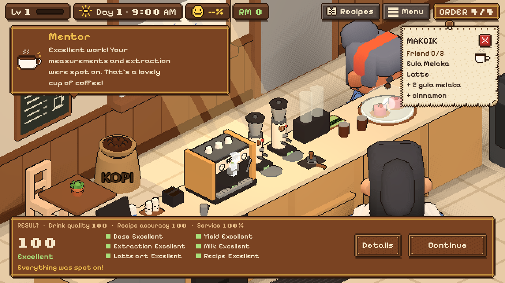

# Brewtopia

*A Malaysian café story.* A cosy barista game for Android, made in Godot 4 for the
5th UMPSA × HUAWEI GameCenter Mobile App Competition (UXHMAC 2026), Category B:
Digital Mobile Games.



You are a new barista learning the trade from a friendly mentor. Customers walk in and tell
you what they want, and you make every drink by hand: weigh and grind the coffee, tamp it,
pull the espresso shot, steam the milk, pour latte art, then add syrups and toppings. Each
drink is scored, the mentor explains what to improve, and the regulars you serve slowly
become friends with stories of their own.

## Features

- **Real espresso craft.** 18 g of coffee in, 36 g of espresso out in 25 to 30 seconds. Grind
  size changes how fast the shot runs; milk is steamed to 60 to 65 °C with the right amount of
  froth.
- **Nine recipes**, unlocked as you level up: Double Espresso, Latte, Gula Melaka Latte, Iced
  Latte, Cappuccino, Iced Gula Melaka Latte, Mocha, Kopi Susu Ais and Caramel Macchiato.
- **Fair, transparent scoring.** Drink quality, recipe accuracy and service, a rating for each
  part of the drink, the exact numbers on request, and one clear tip from the mentor.
- **A living café.** Customers walk in, queue and walk out; four regulars (a student, an office
  worker, a coffee lover and Makcik) each have a three-part story that unlocks with friendship,
  ending in a finale and credits.
- **Progression.** Daily wages and tips, levels, machine upgrades and café decorations.
- **Guided learning.** An objective panel and on-screen highlights walk new players through
  every step; hints are always one tap away.
- **Pixel-art look** for the stations and UI, a 3D isometric café, sound effects and two
  background music tracks with a volume slider and mute in the in-game Menu.

| Café | Espresso bar |
| --- | --- |
|  |  |
| **Toppings** | **Result** |
|  |  |

## How to play

| Action | How |
| --- | --- |
| Tap | Buttons, the tamper, syrup bottles, topping containers, start and stop a shot |
| Drag | Portafilters, cups and the milk pitcher (they snap into place) |
| Hold | The grinder (to grind) and the pitcher in the steam window (to steam) |

1. Drag the portafilter under the grinder, set the grind with − / +, hold the grinder until
   the scale shows about 18 g.
2. Drag it to the mat, tap the tamper, then lock it into a group head.
3. Put a cup on the scale under it and tap the handle to start and stop the shot at about 36 g.
4. Fill the pitcher at the fridge, steam it, pour, and tap for latte art.
5. Add syrups and toppings at the topping station, then drag the drink to **SERVE**.

The full **User Guide** (with screenshots of every screen) is part of the competition submission.

## Running from source

1. Install [Godot 4.7.2](https://godotengine.org/) (standard build).
2. Open `project.godot` in Godot and press **F5**.

The game is laid out for a 1280 × 720 landscape screen and scales to other sizes.

### Android

The `Android` export preset (`export_presets.cfg`) builds an APK with the Gradle build
(arm64-v8a and x86_64). Install the Android build template from Godot first
(**Project → Install Android Build Template**), then export from **Project → Export**.

### Tests

```
Godot_console.exe --headless --path . --script res://tests/test_espresso_model.gd
Godot_console.exe --path . --script res://tests/regression_flow.gd -- <screenshot_dir>
```

`test_espresso_model.gd` checks the scoring rules (prints `PASS`). `regression_flow.gd`
plays a whole Gula Melaka Latte with real mouse events, from grinding to the result screen
(prints `FLOW PASS`; keep the mouse off its window while it runs).

## Project layout

| Folder | Contents |
| --- | --- |
| `scenes/` | Title screen and the café shift |
| `scripts/cafe/` | Day flow, dialogue, orders, results, HUD, friendship |
| `scripts/station/` | The 2D espresso and topping stations |
| `scripts/iso/` | The 3D isometric café, customers and props |
| `scripts/brewing/` | Espresso and drink scoring models |
| `scripts/core/` | Save game, audio |
| `data/` | Recipes, the first shift, daily orders and the regulars' stories (JSON) |
| `tools/` | Scripts that generate the pixel art, fonts and sound effects |
| `addons/HmsPlugin/` | Huawei Mobile Services plugin for Android (integration in progress) |

## Credits

- Game design, story, code and pixel art: the Brewtopia team.
- 3D characters and furniture: [Kenney](https://kenney.nl) (CC0).
- Fonts: Pixelify Sans and Silkscreen (SIL Open Font License, licences in `assets/fonts/`).
- Sound effects: generated for this game (`tools/gen_audio.gd`).
- Background music: "Steam Over Ceramic" and "Sunshine on the Saucer".
- Engine: [Godot](https://godotengine.org/).

Terima kasih for playing!
